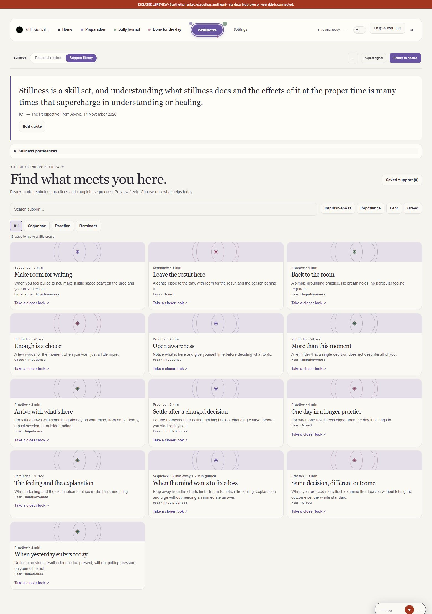
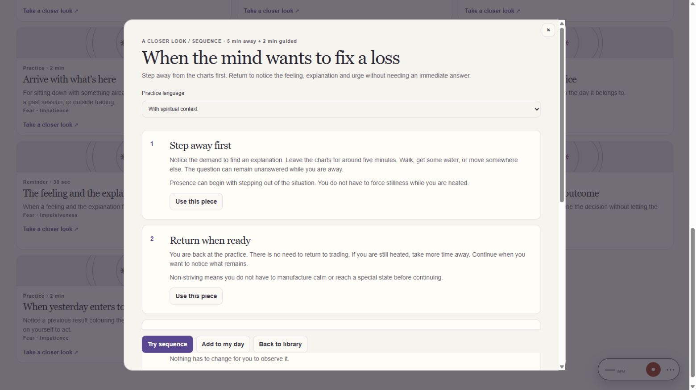
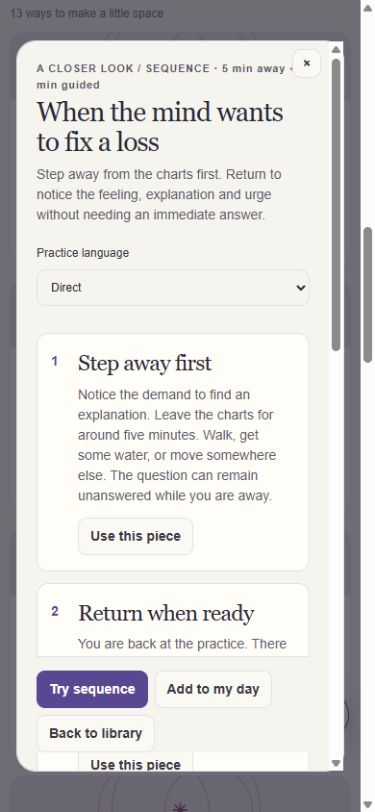
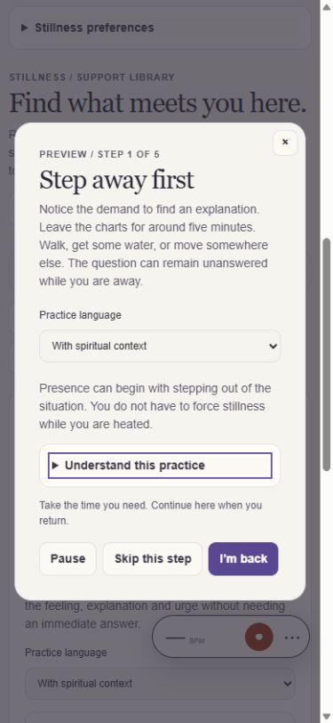

# Personal Stillness practices and deeper guidance

The support library adds four original entries: The feeling and the explanation,
When the mind wants to fix a loss, Same decision, different outcome, and When
yesterday enters today. The previous nine entries retain their order, IDs, and
step indexes. New entries use the existing preview, daily destination, saved
support, and optional Journal flows.

The library shows all cards in a full-width grid, with no persistent preview sidebar.
Selecting a card opens a wide, scrollable overview containing every step's full
text, optional spiritual context, deeper understanding, individual-piece previews,
and Try / Add to my day actions. Closing it preserves the current search and filters.
Opening the overview does not start a practice or create an unfinished draft.

## Try it

1. Open Stillness → Support library. The opening ICT quote appears above browsing.
   Edit it or open Stillness preferences to hide it, restore the default, or change
   practice language. Preferences are saved for this account on this device.
2. Search for `fix a loss`, select the card, and choose Try sequence. This preview
   does not add support to a day. The first step invites a break away from charts.
3. Leave the tab, then return. Time passing does not advance the practice. Choose
   **I’m back** to continue, or skip/exit deliberately. The next step offers
   **Take more time away**.
4. Switch between Direct and With spiritual context without losing your step.
   Open **Understand this practice** using the keyboard or pointer. It explains
   the concepts, gives an example, and links to the influences.
5. Close the dialog or reload. Return to the library and choose **Resume practice**
   to restore the same step. Nothing reopens automatically. **Discard**, or
   finishing the practice, clears the unfinished draft.
6. Use Add to my day to choose Preparation or Done, optionally keeping it in Saved
   support. Beginning daily support uses the same player. Reflect in Journal
   remains an optional existing navigation action and creates no automatic text.

## Data and content

- `ss-stillness-preferences:<owner>` holds language, plain-text quote/attribution,
  and visibility. `ss-stillness-practice:<owner>` holds at most one unfinished new
  practice (choice, step, and preview flag). Both are account-scoped local storage,
  without cross-device sync. Invalid stored values fall back safely; failed writes
  show an explicit message while leaving the practice usable in memory.
- Starting another new practice replaces the unfinished draft. Existing legacy
  practices do not create drafts. A skipped step advances by explicit choice;
  elapsed time is never a completion event. Existing process records are unchanged.
- The owner-keyed library remounts on account changes, resetting transient dialogs
  and editor state before another account can use them. Page/view changes close
  an open player; resuming requires a deliberate action.
- Practice text and spiritual explanations are original. Sources describe influences,
  not endorsement or evidence of guaranteed effects. The practices do not validate
  trading models, classify a loss as random, or instruct a user to enter a trade.
  Explanations describe the ideas in their own right; author names appear only in
  an optional, collapsed Inspiration and further reading section, rather than
  attaching ownership of presence, witnessing, or non-striving to an author.
- The default ICT quotation and attribution are Caleb’s supplied wording, associated
  with The Perspective From Above, 14 November 2026. The dated recording page is
  https://edgeofict.com/learn/ict-spaces/the-perspective-from-above . The exact wording
  has not been independently verified against audio/transcript; no timestamp is claimed.
  The separate original reminder is not attributed as a quotation from Tolle.
- No dependency, database, server API, or migration change is required.

## Verification

Baseline: main `6250627a20e4b80c881daa537c00b2777425e39a` had successful Workers
Builds and Production smoke checks; the live `/api/health` responded successfully.

- `node --import ./tests/browser-environment.mjs --import tsx --test tests/stillness-guidance.test.ts`
  — passed, 6 behavioural tests (full library/card-to-overview navigation,
  language/deeper explanation, away stage, navigation
  and restoration, quote preferences/account isolation, daily destinations/saved
  support, and invalid/unavailable storage).
- `npm run check` — passed: type checking, all 310 tests, production Vite build.
- `git diff --check` — passed.
- Browser review used synthetic `/review` data at desktop size and 390×844.
  Verified quote edit/save/hide/default restoration, switching language without
  advancing, keyboard expansion of deeper understanding, I’m back, taking more
  time, view navigation, and explicit resume after an actual reload.
  The revised grid and wide overview were checked on desktop and 390×844: all
  13 cards are present, all five loss-sequence steps are in the overview, mobile
  has no horizontal overflow, language switching preserves the overview, and
  Try sequence still enters the explicit away/return player.
- The default development server attempted remote AI binding access without a
  Cloudflare token. Browser review instead used a temporary, uncommitted Vite
  configuration with `plugins: [vinext()]`, `APP_ENV=staging`,
  `TRADERPULSE_UI_REVIEW=true`, no cloud backend URL, and port 3195. The temporary
  configuration is not part of the PR. The normal production configuration built
  successfully during `npm run check`.
- Initial component-test harness failures were corrected (React DOM initialization
  and awaiting IndexedDB writes). An exploratory bare `tsc` run after dev-generated
  Worker runtime declarations reported conflicting DOM types; the prescribed
  `npm run check` regenerates declarations without runtime types and passed.
- Build emitted existing toolchain warnings about sourcemaps, chunk size, and route
  classification. No production deployment or signed-in cross-device testing was
  performed. Device-local preferences intentionally do not sync.

## Screenshots

